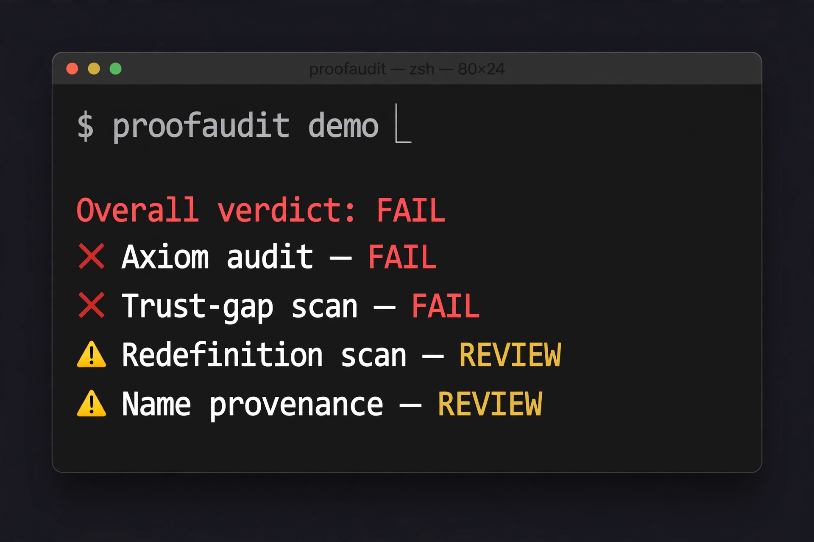
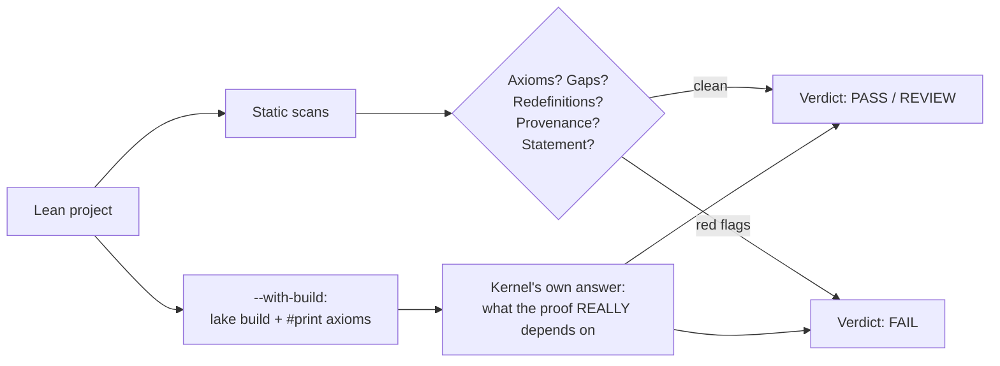

# proofaudit — Agent Math-Code Audit


**17.4 million lines. Zero humans have read them.**

**The proof of the Riemann Hypothesis arrived as code — and code is exactly what we can audit.**

[](https://opensource.org/licenses/MIT)
[](https://nodejs.org/)
[](./package.json)
[](https://github.com/Leizhidong-creator/proofaudit/actions/workflows/ci.yml)
[](https://github.com/Leizhidong-creator/proofaudit/stargazers)

**Claude Code can now prove theorems. ProofAudit checks whether the proof is what it claims to be.**

## The problem

On 20 November 2026, a mathematician working with Claude released a proof of the
Riemann Hypothesis — one of the seven Millennium Prize Problems, unsolved since 1859.

It did not arrive as a paper. It arrived as Lean code: **175,187 files, about 17.4
million lines**, and the author wrote that spelling the argument out in words would
take more than 250,000 pages.

Within a day, the Lean and Mathlib communities certified the formal statement and the
machine-checked proof as correct, and MIT's Andrew Sutherland independently rebuilt
the whole thing with zero errors, using only the three standard axioms. At the same
time, **no human mathematician has yet understood the argument** — Terence Tao says
digesting it will take time, and the author himself says he has not mastered all of
the mathematics around it. The Clay Mathematics Institute still lists the problem as
unsolved: its $1 million prize needs a peer-reviewed publication and two years of
scrutiny.

So we are in a new situation, and it is not going away. AI systems will keep producing
formal proofs that no human can read. The bottleneck is no longer *generating* proofs.
It is **auditing** them.

ProofAudit is the audit pipeline for that world. It automates the exact checks the
community actually ran on the Riemann proof — and that any serious reader should run
on any machine-generated proof.

## Try it in 30 seconds

```bash
npm install -g github:Leizhidong-creator/proofaudit
proofaudit demo
```



`demo` audits a bundled, deliberately flawed "proof" of the Riemann Hypothesis.
Real output:

```
# ProofAudit report — src/demo-fixture

**Overall verdict: ❌ FAIL** — red flags found — see the failing checks.

**Proof size:** 1 file(s), 16 lines, 2 theorem(s)/lemma(s), 1 definition(s), 1 sorry(ies), 1 axiom declaration(s).

| Check | Result | Summary |
|---|---|---|
| Axiom audit | ❌ FAIL | Non-standard axioms found: magicStep |
| Trust-gap scan | ❌ FAIL | 1 hard gap(s), 0 item(s) to review. |
| Redefinition / shadowing scan | ⚠️ REVIEW | This repo defines its own version of standard object(s): RiemannHypothesis. Verify the definition matches the standard one. |
| Name provenance | ⚠️ REVIEW | 1 watched name(s) need origin checks: RiemannHypothesis. |
| Statement match | ⏭️ SKIP | Skipped: needs --theorem <name> and --reference <file>. |

## Axiom audit — details
- declared non-standard axiom `magicStep` — Main.lean:4

## Trust-gap scan — details
- FAIL `sorry` — Main.lean:15 (unfinished proof placeholder)

## Redefinition / shadowing scan — details
- `RiemannHypothesis` (def) — Main.lean:7

## Name provenance — details
- `RiemannHypothesis` — defined-locally: This repo defines its own "RiemannHypothesis". A proof about it proves the local definition, not necessarily the standard object.
```

(File paths shortened for readability. Run it yourself: the output is the tool's,
not a mock-up.)

## How an audit works



## The three questions every audit must answer

1. **Is it proving the real statement?** A proof is only as good as the statement it
   proves. If the code quietly redefines the problem — its own `RiemannHypothesis`,
   its own `zeta` — then the "proof" proves a look-alike. ProofAudit traces where
   every watched name comes from: defined in this repo, or imported from a trusted
   library like Mathlib? And it compares the proved theorem's statement against a
   reference statement, word for word.
2. **Was anything smuggled in?** A proof that leans on an extra axiom, or on `sorry`
   — Lean's "trust me, this part works" placeholder — is not a proof. ProofAudit scans
   for both, and with `--with-build` it asks the kernel itself what the proof really
   depends on via `#print axioms`. Declarations can lie; the kernel cannot.
3. **Is it finished?** Proof size, theorem counts, gaps, and whether the whole project
   actually builds. A `lake build` that exits 0 means every proof was elaborated and
   kernel-checked. Anything else is a draft.

## What it checks

| Check | What it catches | Why it matters |
|---|---|---|
| **Axiom audit** | Extra axioms beyond the three Lean standard ones (`propext`, `Classical.choice`, `Quot.sound`) | An extra axiom is an extra assumption — the proof may be proving something weaker, or nothing at all. |
| **Trust-gap scan** | `sorry`, `admit`, `sorryAx`, plus `native_decide` / `unsafe` flagged for review | `sorry` means "unfinished". A proof full of them is a sketch. |
| **Redefinition scan** | The repo defining its own version of a standard object | The classic way to "prove" a hard theorem: prove an easier look-alike instead. |
| **Name provenance** | Where each watched name comes from — defined locally, imported from Mathlib, or unclear | This is the check that answers the "were the definitions rigged?" question. In the Riemann case the answer was: no — the statement was Mathlib's own, in the library since 2023. |
| **Statement match** | The proved theorem vs. a reference statement (`--theorem` + `--reference`) | Text-level proof that the theorem proved is the theorem claimed. |
| **Kernel check** (`--with-build`) | Runs `lake build` and a `#print axioms` probe with the real toolchain | The strongest check there is. Only the kernel can confirm a proof is valid. |

Verdicts: **PASS** (no red flags), **REVIEW** (nothing failed, needs a human look),
**FAIL** (red flags found). Exit code is 1 on FAIL, so it works in CI. `--json`
output is built for agents to consume.

## Install

```bash
# From GitHub (works today)
npm install -g github:Leizhidong-creator/proofaudit

# From source
git clone https://github.com/Leizhidong-creator/proofaudit.git
cd proofaudit
node bin/proofaudit demo
```

Zero dependencies. Node >= 20. The npm registry release (`npm install -g proofaudit`)
is being prepared — the package name is free and the publish workflow is in the repo.

## Usage

| Command | What it does |
|---|---|
| `proofaudit demo` | Audit the bundled flawed proof — the fastest way to see the tool work |
| `proofaudit audit <path>` | Audit any Lean project (static checks, no toolchain needed) |
| `proofaudit audit <path> --preset rh` | Audit with the Riemann Hypothesis preset |
| `proofaudit audit <path> --preset rh --theorem RiemannHypothesis --reference ./mathlib-rh.txt` | Also match the proved statement against Mathlib's reference statement |
| `proofaudit audit <path> --preset rh --theorem RiemannHypothesis --with-build` | Full audit: `lake build` + `#print axioms` probe with the real toolchain (slow — a full build of 175,187 modules takes hours) |
| `proofaudit audit <path> --json` | Machine-readable report for agents and CI |
| `proofaudit audit <path> --md report.md` | Also write the Markdown report to a file |

## Worked example: auditing the Riemann claim

```bash
# 1. Static audit — runs anywhere, no toolchain needed
proofaudit audit ./riemann-hypothesis --preset rh

# 2. Full audit — needs Lean installed (elan) and the project to build
proofaudit audit ./riemann-hypothesis --preset rh \
  --theorem RiemannHypothesis --with-build
```

The `--preset rh` preset encodes the public facts of the November 2026 claim: the
three standard axioms are the only ones allowed, `RiemannHypothesis` / `zeta` and
related names are watched, and the report quotes the public verification record as
*external evidence* — the Lean & Mathlib certification and Sutherland's rebuild —
labelled as such. ProofAudit quotes that evidence; it does not re-verify it. Only
`--with-build` on your own machine does that.

## Why not just run `lake build`?

| Approach | Confirms validity | Catches `sorry` | Catches redefined statements | Catches extra axioms | Runs without Lean |
|---|---|---|---|---|---|
| `lake build` | ✅ (kernel) | ❌ (fails the build, no report) | ❌ | ❌ | ❌ |
| `#print axioms` by hand | Partial | ❌ | ❌ | ✅ | ❌ |
| **proofaudit (static)** | ❌ | ✅ | ✅ | ✅ | ✅ |
| **proofaudit `--with-build`** | ✅ (kernel) | ✅ | ✅ | ✅ | ❌ |

`lake build` is the strongest single check — and proofaudit runs it for you, then adds
the checks it cannot do: what the statement actually is, where its names come from,
and whether anything was left unfinished.

## FAQ

**Does a PASS mean the proof is correct?**
No. A PASS means "no red flags found by these checks". Only the kernel check
(`--with-build`) can confirm validity — and a full rebuild of a proof the size of
the Riemann one takes hours on many cores. Understanding is still a human job, and
for the Riemann proof it has not happened yet.

**Does it need Lean installed?**
Only for `--with-build`. The static checks run anywhere with Node 20+.

**What about Mathlib as a dependency?**
The provenance check treats Mathlib imports as trusted: a name that resolves to
Mathlib is the shared library definition. A name defined in the audited repo itself
is flagged for review.

**Can I use it in CI?**
Yes. Exit code 1 on FAIL, `--json` for machines, and a GitHub Actions workflow in
`.github/workflows/ci.yml` runs the self-tests on every push.

## Honest limits

- The static checks run anywhere, but they are **not** a validity proof. Only the
  kernel check (`--with-build`) can confirm a proof is valid.
- A PASS means "no red flags found by these checks", not "a human mathematician
  has understood the proof."
- Statement matching is textual (after normalisation). It catches a redefined
  statement, not a subtly different-but-equivalent one; that judgement still needs
  a mathematician.

## Roadmap

- MCP server, so Claude Code and other agents can call the audit directly.
- Kernel replay via `leanchecker` for projects without a full `lake build`.
- More presets (other Millennium Problems, common Mathlib statements).
- npm registry release.

## Contributing

Issues and pull requests are welcome. Run `node test/selftest.js` before submitting —
all 12 self-tests must pass. If you add a check, add a fixture and a test for it.

## License

MIT
